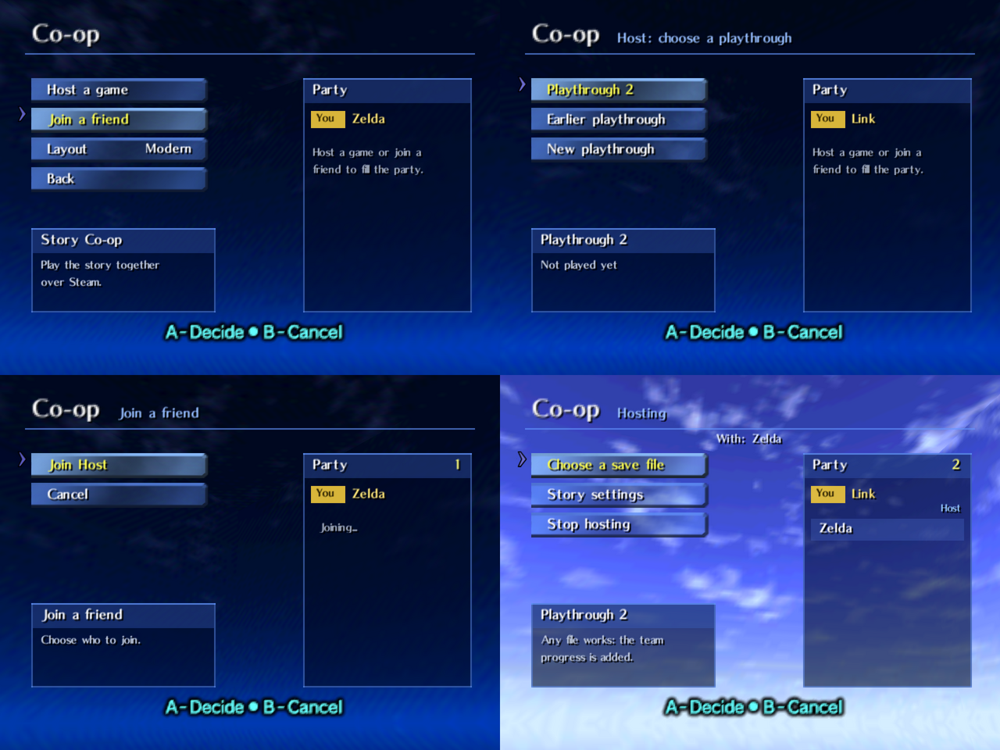
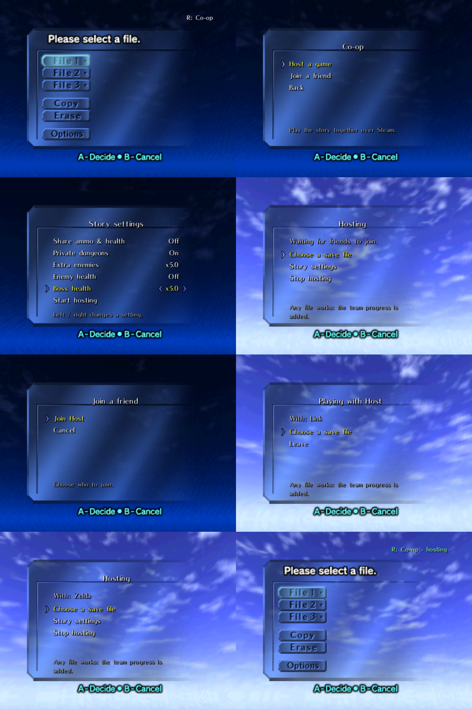

# Ocarina of Time Story Co-op (Time Fix fork)

**Play the whole of Ocarina of Time with friends: one shared story, one team save, and you time travel together.**

This is a fork of [cranebeaker/ocarina-coop](https://github.com/cranebeaker/ocarina-coop), the Story Co-op mode for
[Ship of Harkinian](https://github.com/HarbourMasters/Shipwright) (the PC port of Ocarina of Time) built on the
online netcode of [ShipwrightOnline](https://github.com/lukegrahamSydney/ShipwrightOnline). It is based on upstream
**v1.0.5** and adds an in-game Co-op Lobby, a world clock that behaves like the original game, menus that don't pause
the world, adjustable difficulty and a few more Story Co-op fixes. Everything upstream does still works the same way.

> **You need your own Ocarina of Time ROM.** No game files are included. On the first start the game builds its
> assets from your ROM.

## Download and play

Get the latest build from [Releases](https://github.com/reaffirmed/ocarina-coop-timefix/releases/latest):

| System | Download |
| --- | --- |
| Windows | `OcarinaStoryCoop-windows.zip` |
| Linux and Steam Deck | `OcarinaStoryCoop-...-linux.tar.gz` |
| macOS | No build yet |

1. **Extract** the download into its own folder.
2. **First start:** run `soh.exe` (Windows) or `soh.appimage` (Linux). Pick your ROM when asked. Building the
   assets takes about a minute and only happens once.
3. **Play together:** everyone needs Steam running and logged in. The connection goes through Steam's relay
   network (Valve's free "Spacewar" app), so there are no IP addresses and no port forwarding.

Everyone in the party must use the same release of this fork. Servers from ShipwrightOnline, upstream Story Co-op
and other releases turn the game away with "Wrong server version".

### Option A: the in-game Co-op Lobby

On the file select screen, press **R** to open the **Co-op** menu. You use it with the controller.

- **Host a game:** pick a playthrough to continue (or start a new one), check its story settings, then choose
  **Start hosting**. The server, a friends-only Steam lobby and the Story Co-op party are set up for you in the
  background.
- **Join a friend:** shows the Steam friends who are hosting. Pick one and you are added to their party by
  yourself.
- **Your name** is what the others see. It starts as your Steam name; change it with the letter grid (A types, B
  deletes, START saves).
- **Start a new co-op file** / **Continue co-op file** starts the game. Each playthrough has its own co-op save file,
  so your three solo files are never touched online. **Copy a solo file** brings one of them along, once, one way (the
  solo file stays as it is). The top right shows "R: Co-op - hosting" or "- with <name>".
- **Story settings** can be changed by the host for the whole party while hosting: share ammo and health, private
  dungeons, extra enemies, enemy health, boss health and enemy damage, and the optional co-op rules below.
- **Layout** switches between **Classic** (inside the game's own file select window) and **Modern** (a full screen
  view with the party list).

The lobby remembers each playthrough: its team code, when you last played it, with whom and on which file. A window
version of the lobby is also in the menu bar under **Network > Zelda Online > Co-op Lobby**.

### Option B: the Steam scripts

These come from upstream and still work.

- **Host:** run `Host over Steam.bat` (Windows) or `Host over Steam.sh` (Linux). It starts the server, opens a
  friends-only Steam lobby and starts your game.
- **Join:** your friend runs `Join over Steam.bat` or `Join over Steam.sh`. It finds you on their friends list by
  itself. With it open, right-clicking you in Steam and choosing Join Game works too.
- Then the host opens the online window, creates a party with **Story Co-op** turned on, and invites everyone.

**Steam Deck Game Mode:** in Desktop Mode, open Steam > Games > Add a Non-Steam Game to My Library > Browse, set the
file type to "All Files", pick `Join over Steam.sh` (or `Host over Steam.sh`) and add it. Start it from your library
in Game Mode. Errors show in a dialog and are written to `OOTSteamLink.log`. The `README.txt` in the Linux download
has the details.

### Option C: play by address

Run `server/OOTServer.exe` (or `Start Server.sh` on Linux) and connect by address and port 21050 from the online
window, as in ShipwrightOnline. For play over the internet, forward TCP port 21050 or use a private network such as
Tailscale or ZeroTier.

## What this fork adds

- **In-game Co-op Lobby** on the file select (see above), in Classic and Modern layouts, with host, join, save
  select, per-playthrough story settings and a remembered list of playthroughs.
- **Time that passes like in the original game.** Upstream ran a shared clock in nearly every scene, so time passed
  in Kokiri Forest, towns, interiors and dungeons. Now the shared clock only moves while a player is somewhere time
  normally passes, such as Hyrule Field.
- **Menus that don't pause the world.** While you are online, the pause menu and the Ocarina no longer freeze the
  game. Enemies, other players and the rest of the scene keep moving, and Link stands still while you are in the
  menu. To get vanilla pausing back, turn off **Keep the game running in menus** in the Zelda Online menu.
  Offline play is unchanged.
- **Enemy damage scaling.** A **Damage Multiplier** party option (with an **Enemy Damage Weight** slider) next to
  the existing enemy and boss health multipliers. It makes enemy hits stronger with more players:
  `1 + 0.25 x party size x weight`, capped at 3x. Like the health options it needs Private Dungeons, only applies in
  dungeons and boss rooms, and is off by default.
- **A separate Epona for each player.** Once anyone has Epona, everyone summons and rides their own with Epona's
  Song, and each player's Epona waits where that player left her.
- **Vote before warp cutscenes.** Cutscenes that take the party to another scene (blue warps, the Chamber of Sages,
  Kakariko burning and similar) wait until everyone in the same area is ready. Press **L** to say you are ready (B
  takes it back). The player who started it can press L to go right away. If the server doesn't answer within 3
  seconds (an older server, for example), the warp goes ahead, so nobody gets stuck.
- **Join or skip a cutscene.** When another player starts a story cutscene in your area, a 3 second countdown
  appears first. Do nothing to watch it with them, or press **L** to skip it and keep playing. The story progress
  still reaches you.
- **Story fixes:** Mido, King Zora and the Kakariko gate move as soon as another player's story flag arrives, and
  the Great Deku Tree cutscenes are watched together.

- **Optional co-op rules**, all off by default and set per playthrough by the host (details in
  [STORY_COOP.md](docs/story-coop/STORY_COOP.md#co-op-rules)):
  - **Friendly fire:** Off, Light (half damage, never your last heart) or Full. Never during cutscenes, text or votes.
  - **Revives:** when you die near a teammate you go down for 30 or 60 seconds. A teammate plays Zelda's Lullaby next
    to you (48 magic, back with 3 hearts) or uses a bottle on you: a fairy (8 hearts), a red potion (full hearts) or a
    blue potion (full hearts and magic). Potions and milk also heal a teammate who is up; a green potion refills magic.
  - **Death penalty:** a Game Over leaves a marker with some of your rupees (none, a quarter, half or all) where you
    fell. Optionally, as adult, Dark Link guards it in your game only.
  - **Respawn cooldown** of 5 or 10 seconds, and a **ready check** at dungeon entrances and boss doors.
- **Co-op menu in game:** pause and press L to **Teleport to** a teammate.
- **What you got on joining:** joining a playthrough that is further along shows what the team's progress gave you.

Proximity voice chat is not included.

Note that L also toggles the minimap in vanilla, so pressing L to vote or skip will toggle it too.

## Story Co-op (from upstream)

- **Shared:** weapons, items, songs, medallions, stones, heart containers and pieces, magic, upgrades, story flags,
  Gold Skulltulas, Big Poe points, scarecrow songs and map progress. One player finds the Hookshot, everyone has it.
- **Kept per player:** rupees, ammo and health (a party setting shares them too), bottle contents and one-time NPC
  gifts.
- **Dungeons:** keys, switches, chests, cleared rooms and pickups update live for everyone in the dungeon and are
  saved for the team. The Water Temple water level and the Forest Temple elevator are shared like in single player.
- **Story cutscenes together:** everyone in the same area watches a story cutscene at the same moment. Area intros
  still play on your own first visit if you were elsewhere.
- **Time travel together:** pulling the Master Sword puts you on hold until every player has pulled it, then the
  whole party travels. The party is always in the same era.
- **Team save on the server:** survives server restarts, keeps backups and recovers from a damaged file. Late joiners
  and reconnects catch up straight away. Every Story Co-op party has a team code.
- **Enemies and bosses** are synced by the ShipwrightOnline netcode, so everyone fights the same enemy.
- **Skins:** ShipwrightOnline's online skins work as before. See [tools/skinconv/readme.txt](tools/skinconv/readme.txt)
  to convert a skin and add it to the server's `config.json`.

The full design is in [docs/story-coop/STORY_COOP.md](docs/story-coop/STORY_COOP.md).

## Known limits and what is untested

- **Joining through the in-game lobby over real Steam has not been tested yet.** It was tested with two game
  instances on Linux against a mock Steam library. If it gives you trouble, use the Steam scripts (Option B), which
  are the route upstream ships.
- **No macOS build yet.** A fix for the Mac build is in progress.
- The Linux download is a development build of the same code as the Windows release.
- The enemy Damage Multiplier has a test scenario but has not been played through in a real session.
- Not yet covered by tests: warp songs and songs played for NPCs with the non-pausing menus, and two players riding
  their Eponas side by side.

## Building

See [docs/BUILDING.md](docs/BUILDING.md). The server is in [server/](server) and the Steam relay helper is in
[tools/steamlink/](tools/steamlink).

## Credits

- [cranebeaker/ocarina-coop](https://github.com/cranebeaker/ocarina-coop): Story Co-op and the Steam relay, which
  this fork is built on. Upstream is part of
  [Co-op Anything](https://github.com/cranebeaker/coop-anything), and you can support its author on
  [Ko-fi](https://ko-fi.com/cranebeaker).
- [ShipwrightOnline](https://github.com/lukegrahamSydney/ShipwrightOnline) by lukegrahamSydney: the online netcode,
  enemy and boss sync, parties and skins.
- [Ship of Harkinian](https://github.com/HarbourMasters/Shipwright) by HarbourMasters: the PC port. See
  [docs/CREDITS.md](docs/CREDITS.md).
- Steam relay: Valve's Steamworks runtime (`steam_api64.dll` / `libsteam_api.so`).

This is a fan project. It is not affiliated with or endorsed by Nintendo, and it does not include any of the game's
code or assets. You must supply your own legally obtained copy of Ocarina of Time.
